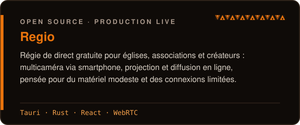
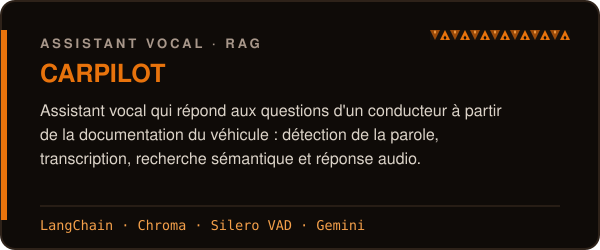
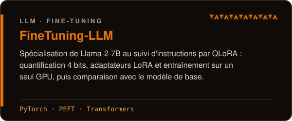
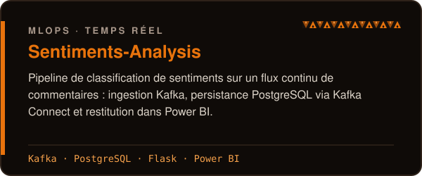
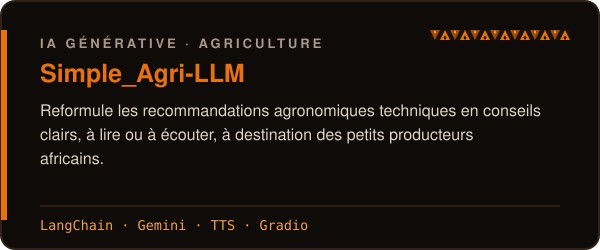
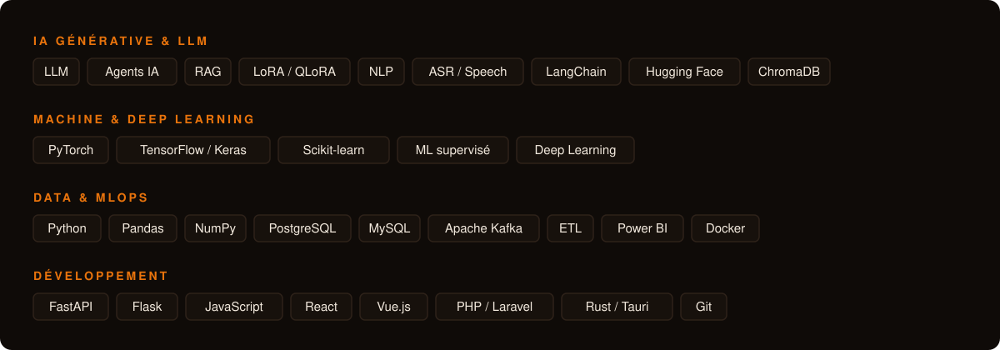

  

  <i>L'intelligence artificielle est en train de redessiner le monde. 
  L'Afrique a mieux à faire que de la regarder passer.</i>

 

L'intelligence artificielle se conçoit aujourd'hui dans une poignée de laboratoires, à partir de données et de langues qui ne sont pas les nôtres. Des centaines de millions de personnes restent ainsi à la porte d'une technologie qui prétend pourtant s'adresser à tous.

Cela peut changer. L'Afrique a les esprits, les langues, les problèmes à résoudre et l'énergie nécessaires pour devenir un véritable foyer de création en IA. Je veux prendre part à ce mouvement : concevoir, depuis le continent, des systèmes qui partent de nos réalités, et contribuer à la recherche plutôt que d'en attendre les résultats.

C'est ce qui guide chacun de mes projets, et c'est la raison d'être de **[Tree AI Lab](https://github.com/Tree-Ai-lab)**, le laboratoire de recherche que j'ai cofondé.

 

**Donner une voix à nos langues.** Avec Kouman AI, nous apprenons à une intelligence artificielle à comprendre et à parler les langues ivoiriennes, à l'écrit comme à l'oral, en commençant par le baoulé. Un premier modèle est déjà ouvert à tous ; les suivants le seront aussi.

**Des agents qui font le travail.** Je conçois des systèmes multi-agents et des assistants RAG qui prennent en charge des tâches entières, de la collecte de l'information à sa restitution. L'un d'eux ramène à quelques minutes la rédaction de rapports d'analyse qui mobilisait auparavant une journée complète.

**Aller jusqu'à la recherche.** Utiliser les modèles ne me suffit pas ; je veux comprendre ce qui les fait fonctionner, pour un jour en proposer de nouveaux.

 

  
  
  
  
  
  

 

  

 

  Chercheur, ingénieur ou simplement convaincu que l'avenir de l'IA s'écrit aussi en Afrique ? 
  <b>Construisons-le ensemble.</b>

  <a href="https://www.linkedin.com/in/jaures-ngangoula-4413023b4/"><b>LinkedIn</b></a>
  &nbsp;&nbsp;|&nbsp;&nbsp;
  <a href="https://github.com/Tree-Ai-lab"><b>Tree AI Lab</b></a>
  &nbsp;&nbsp;|&nbsp;&nbsp;
  <a href="https://huggingface.co/Tree-AI-lab"><b>Hugging Face</b></a>

