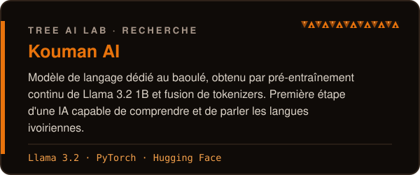

  

  <a href="https://www.linkedin.com/in/jaures-ngangoula-4413023b4/"><b>LinkedIn</b></a>
  &nbsp;&nbsp;|&nbsp;&nbsp;
  <a href="https://github.com/Tree-Ai-lab"><b>Tree AI Lab</b></a>
  &nbsp;&nbsp;|&nbsp;&nbsp;
  <a href="https://huggingface.co/Tree-AI-lab"><b>Hugging Face</b></a>

 

Ingénieur AI/ML, je conçois des systèmes d'intelligence artificielle appliqués : agents, architectures RAG, modèles de langage et traitement de la parole. Ma démarche reste la même d'un projet à l'autre : partir d'un besoin concret et aboutir à une solution fiable, réellement utilisée.

Ce qui m'anime dépasse toutefois la technique. L'Afrique possède les talents, les langues, les données et les enjeux pour participer pleinement à la construction de l'intelligence artificielle. Pourtant, elle se contente encore trop souvent d'en consommer les produits. Je veux contribuer à changer cette position : que le continent ne soit plus spectateur de cette révolution, mais l'un de ses acteurs, capable de concevoir des modèles qui partent de ses propres réalités.

C'est dans cette perspective que j'ai cofondé **Tree AI Lab**, et que je m'oriente vers la **recherche en IA** : comprendre les modèles en profondeur pour, demain, en proposer de nouveaux.

 

**Cofondateur & AI Research Engineer** · [Tree AI Lab](https://github.com/Tree-Ai-lab) 
Laboratoire indépendant de recherche en intelligence artificielle, dont les travaux sont publiés en open source.
- Direction de **Kouman AI**, une IA conçue pour comprendre et parler les langues locales, à l'écrit comme à l'oral, en commençant par le baoulé.
- Trois versions du modèle développées à ce jour ; une version publique est en préparation.

**AI & Automation Engineer** · Veilleur des Médias 
Veille médiatique, analyse des médias et e-réputation.
- Conception d'un **système multi-agents** qui automatise la rédaction des rapports d'analyse média : leur production passe d'une journée de travail à quelques minutes.
- Développement de bout en bout d'un **assistant conversationnel RAG** pour le site de l'entreprise, capable de transmettre automatiquement les demandes complexes au service client.
- Identification des cas d'usage à forte valeur et intégration de solutions ML, NLP et d'IA générative dans les différents départements.

 

  
  
  
  
  
  

  <a href="https://github.com/ngangoula-jaures?tab=repositories">Voir l'ensemble des dépôts</a>

 

  

 

<i>Penser, concevoir et produire l'intelligence artificielle en Afrique.</i>

