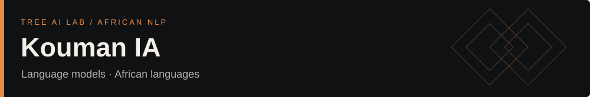

Je conçois et développe des systèmes d'intelligence artificielle, de l'expérimentation des modèles à leur mise en production.

Mes travaux s'inscrivent à la croisée de l'ingénierie et de la recherche, avec une conviction : l'Afrique a pleinement sa place dans la production de connaissances et la construction de l'avenir de l'intelligence artificielle.

---

### Research & Engineering

**01 / Language Models & NLP** 
Adaptation, fine-tuning et évaluation de modèles de langage.

**02 / Agentic AI** 
Systèmes multi-agents, architectures RAG et orchestration.

**03 / Machine Learning** 
Modélisation, expérimentation et déploiement.

---

### Featured Project

Développement de modèles de langage et de ressources linguistiques pour les langues africaines, notamment le baoulé.

[Tree AI Lab](https://github.com/Tree-Ai-lab) &nbsp;·&nbsp; [Hugging Face](https://huggingface.co/Tree-AI-lab)

---

<i>Reach For The Stars!</i>

